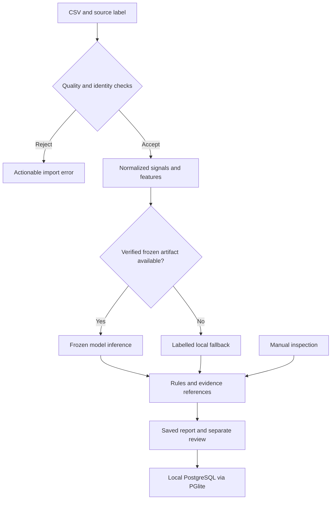
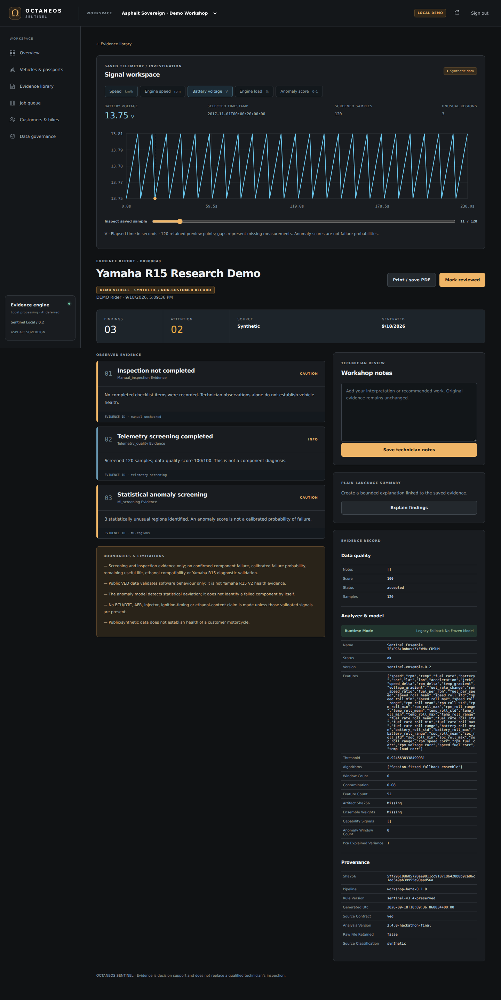

# OctaneOS — Vehicle Data Intelligence

**Asphalt Sovereign | Local 0.2 prototype | Engineering consolidation: 12 November 2026**

CSV telemetry screening and a local workshop evidence workflow. Start here for the current scope; older hackathon documents remain historical records.

## 1. Problem

Vehicle measurements, inspection observations and repair explanations can become disconnected. This prototype links a report to its input provenance, data-quality checks, analysis mode and technician review.

## 2. Automotive relevance

An unusual signal is a reason to investigate. It is not proof of a failed component. Automotive diagnostic work needs traceable measurements, explicit units, missing-signal handling and a clear boundary between observation and interpretation.

## 3. Engineering requirements

| Requirement | Implementation or acceptance evidence |
|---|---|
| Validate supported CSV contracts | VED-shaped demonstration data and the declared SAN importer contract |
| Keep source classification visible | Synthetic, public data, manual inspection and vehicle telemetry labels |
| Expose actual model mode | Frozen artifact integrity check; labelled session-fitted fallback when absent |
| Preserve saved evidence | Separate inspection snapshots, evidence reports and technician notes |
| Scope workshop records | Membership checks and PostgreSQL policies; local PGlite tests |
| Work without cloud AI | Deterministic local explanation; local launcher disables cloud AI |
| Provide reproducible checks | Python lockfile, npm lockfiles, backend tests and chart tests |

## 4. Selected architecture



## 5. Technology selection

Python/FastAPI keeps ingestion, engineering checks and statistical analysis together. React/TypeScript renders the evidence workspace. PostgreSQL records support scoped membership and immutable evidence. PGlite runs PostgreSQL compiled to WebAssembly for the local demonstration; it does not establish native PostgreSQL concurrency or hosted authentication readiness.

## 6. Implemented

Recovered Local 0.2 includes demo entry, workshop setup, customer and vehicle records, job intake, manual inspection, CSV screening, saved reports, technician notes, review/closure, service history, search/filter controls, telemetry charts and browser printing. Source is in [backend/](backend/) and [frontend/](frontend/); [src/README.md](src/README.md) maps the implementation.

## 7. Testing

```bash
.venv/bin/python tools/verify-local.py
npm --prefix frontend run build
node --test tools/chart-math.test.mjs
```

The Python runner starts a disposable local PGlite database and applies the supplied migrations. See [reports/verification-2026-11-12.md](reports/verification-2026-11-12.md) for this consolidation's actual command results. Earlier release results are retained under `verification/` and are explicitly historical.

## 8. Actual results

The packaged application runs in local demonstration mode with synthetic examples. The authentic frozen `sentinel-powertrain-baseline-0.5` binary is absent; the current fallback is fitted to the uploaded session and has no prospective diagnostic-accuracy claim.

The September training record reports 76.33% controlled-perturbation run detection and **13.01% untouched-normal false-positive rate** on held-out passenger-car data. Those are historical reported research results, not reproduced here, not the performance of the current fallback, and not motorcycle fault-diagnosis accuracy. See [reports/research-results-boundary.md](reports/research-results-boundary.md).

## 9. Limitations and known issues

- No measured R15 diagnostic accuracy, remaining-useful-life, ethanol, emissions or ECU-control result.
- The recovered SAN bench firmware and this importer's SAN contract differ. They are **not yet plug-compatible**; see [docs/SAN_INTEGRATION_GAP.md](docs/SAN_INTEGRATION_GAP.md).
- Hosted Supabase sign-in, native PostgreSQL concurrency, Windows execution, Docker deployment and a real workshop pilot remain unverified in this consolidation.
- Real customer data is outside this local demonstration's intended use. No operational customer database is included.
- A historical screenshot is UI evidence only. No new browser end-to-end run is claimed by this consolidation.

## 10. Next engineering milestone

Freeze a versioned SAN-to-OctaneOS adapter contract, then import a genuine USB-bench log with calibration provenance and no unsupported signal inference. Separately recover the checksum-matching trained artifact or retrain a clearly versioned model with a held-out evaluation.

## Installation and dependency versions

Requirements: Python **3.12**, Node.js **22.12 or newer in the 22.x line, or 24.x** (verified here with **24.22.1**), npm, a modern browser and internet for the first dependency installation. A normal laptop is sufficient; no vehicle hardware, paid account or AI key is needed for the local demonstration. The repository does not establish a minimum RAM/storage benchmark.

Linux/macOS, from the repository root:

```bash
python3.12 -m venv .venv
.venv/bin/python -m pip install -r backend/requirements-lock.txt
npm --prefix tools ci --omit=dev
npm --prefix frontend ci
npm --prefix frontend run build
.venv/bin/python tools/run-demo.py
```

Open **http://127.0.0.1:8000**, choose **Enter demonstration workshop**, and use synthetic records. Keep the process running while using the app. Windows: use `START_SENTINEL_WINDOWS.cmd` or the manual commands in [README_LOCAL_RELEASE.md](README_LOCAL_RELEASE.md); the Windows launcher has not been executed in this consolidation.

Resolved package versions in the supplied lockfiles include FastAPI **0.128.2**, pandas **2.2.3**, NumPy **2.3.5**, scikit-learn **1.8.0**, React/React DOM **19.3.0**, TypeScript **7.0.2** and Vite **8.3.0**. Full Python versions: [backend/requirements-lock.txt](backend/requirements-lock.txt). Frontend/database-tool versions: their `package-lock.json` files. Use lockfiles rather than `npm install` to reproduce dependencies.

## Demonstration and sample data



This is an unchanged screenshot recovered from the **18 September Local 0.2** package. It contains intentionally synthetic demonstration records. It is not a new vehicle test or a newly captured browser run. [assets/README.md](assets/README.md) records its provenance.

[data/samples/](data/samples/) contains synthetic examples with location fields removed. The originals under `samples/` are historical synthetic demonstrations; they are not SAN measurements. [docs/RELEASE_LINEAGE.md](docs/RELEASE_LINEAGE.md) explains source recovery, the current publication commits and the earlier history retained in a Git bundle.

Engineering portfolio: [Asphalt Sovereign](https://github.com/asphaltsovereign/automotive-engineering-portfolio).
